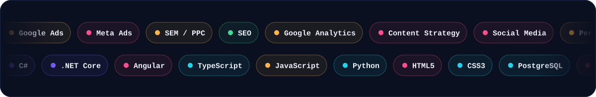

  

 

I work where **growth marketing meets engineering**. Around **10 years** across performance marketing, full-stack development and operations: Digital Media Consultant at **Google Operations Center**, time at **Genpact**, Operations Manager at **Harphil**, and founder of **[Brand E5 (BE5)](https://brande5.com)**, a digital marketing, web development and AI consulting company.

That mix means I can plan the campaign, build the site it lands on, wire up the tracking and automate the reporting. **One person, the whole funnel.**

 

 

 

  

 

<table>
<tr>
<td width="50%" valign="top">

### 🏠 [WGfinder](https://flatsingermany.com)
`flatsingermany.com` · **Rental platform for Germany**

End-to-end portal for apartment rentals in German cities: property listings, visit bookings, contract management, complaints and payments.

   

</td>
<td width="50%" valign="top">

### 🏢 [VisionM HRMS](https://visionm.in)
`visionm.in` · **Enterprise HR management**

Full HRMS: attendance, leave, payroll, recruitment, training and system configuration with role-based access control.

   

</td>
</tr>
<tr>
<td width="50%" valign="top">

### 🤖 AI Automation Pipelines
**n8n + local LLMs**

Workflows that connect data sources to AI processing stages. Local models through Ollama (Hermes, Mistral) for private, offline inference, from data extraction to automated reporting.

  

</td>
<td width="50%" valign="top">

### 📊 Internal CRM
**Operations and task management**

Task assignment, workflow automation and operational reporting, integrated with Salesforce Service Cloud for case routing and SLA tracking.

   

</td>
</tr>
</table>

 

Design, development, launch and marketing for businesses in India and Germany, delivered through **Brand E5**. A selection of live work:

<table>
<tr><th align="left">Site</th><th align="left">Industry</th><th align="left">What I delivered</th></tr>
<tr><td> <a href="https://brande5.com"><b>Brand E5</b></a></td><td>Digital marketing, web and AI</td><td>My company: brand, website, growth</td></tr>
<tr><td> <a href="https://flatsingermany.com"><b>flatsingermany.com</b></a></td><td>Real estate and rentals</td><td>Full-stack app, booking engine, payments</td></tr>
<tr><td> <a href="https://dhanalakshmigroup.com"><b>dhanalakshmigroup.com</b></a></td><td>Construction and interiors</td><td>Website design and development, SEO</td></tr>
<tr><td> <a href="https://www.vdesignss.com"><b>vdesignss.com</b></a></td><td>Branding and signage</td><td>Website build, digital marketing</td></tr>
<tr><td> <a href="https://shizconlogistics.com"><b>shizconlogistics.com</b></a></td><td>Logistics and transport</td><td>Corporate website, content marketing</td></tr>
<tr><td> <a href="https://sukridha.com"><b>sukridha.com</b></a></td><td>Business services</td><td>Planning, deployment, marketing</td></tr>
<tr><td> <a href="https://harphil.com"><b>harphil.com</b></a></td><td>Corporate services</td><td>Website, email domain, digital presence</td></tr>
<tr><td> <a href="https://ayaatih.com"><b>ayaatih.com</b></a></td><td>Business services</td><td>Setup, management, marketing</td></tr>
</table>

> Full-service delivery: Google Ads, SEO, social media, content strategy and performance marketing.

 

<picture>
  <source media="(prefers-color-scheme: dark)" srcset="https://raw.githubusercontent.com/bharath32/bharath32/output/github-snake-dark.svg"/>
  <source media="(prefers-color-scheme: light)" srcset="https://raw.githubusercontent.com/bharath32/bharath32/output/github-snake.svg"/>
  
</picture>

 

 

  

