


<a href="https://flatsingermany.com"></a>
<a href="https://visionm.in"></a>

<a href="https://brande5.com"></a>
<a href="https://flatsingermany.com"></a>
<a href="https://dhanalakshmigroup.com"></a>
<a href="https://www.vdesignss.com"></a>
<a href="https://shizconlogistics.com"></a>
<a href="https://sukridha.com"></a>
<a href="https://harphil.com"></a>
<a href="https://ayattih.com"></a>


<picture>
  <source media="(prefers-color-scheme: dark)" srcset="https://raw.githubusercontent.com/bharath32/bharath32/output/github-snake-dark.svg"/>
  <source media="(prefers-color-scheme: light)" srcset="https://raw.githubusercontent.com/bharath32/bharath32/output/github-snake.svg"/>
  
</picture>

<a href="https://linkedin.com/in/bharathyadav3000">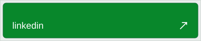</a>
<a href="mailto:bharathyadav.exe@gmail.com">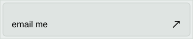</a>
<a href="https://brande5.com">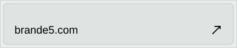</a>

Set in Mona Sans and Mona Sans Mono (SIL Open Font License). Animations are pure SVG, regenerate with <code>python3 scripts/build_svgs.py</code>.

